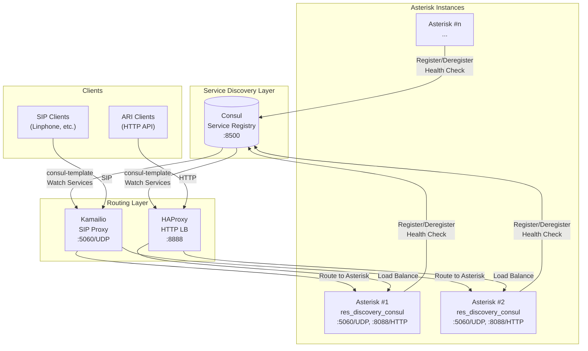
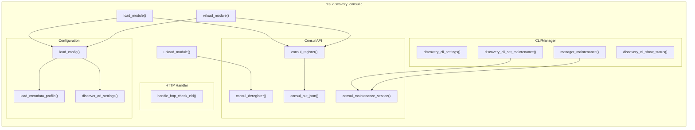
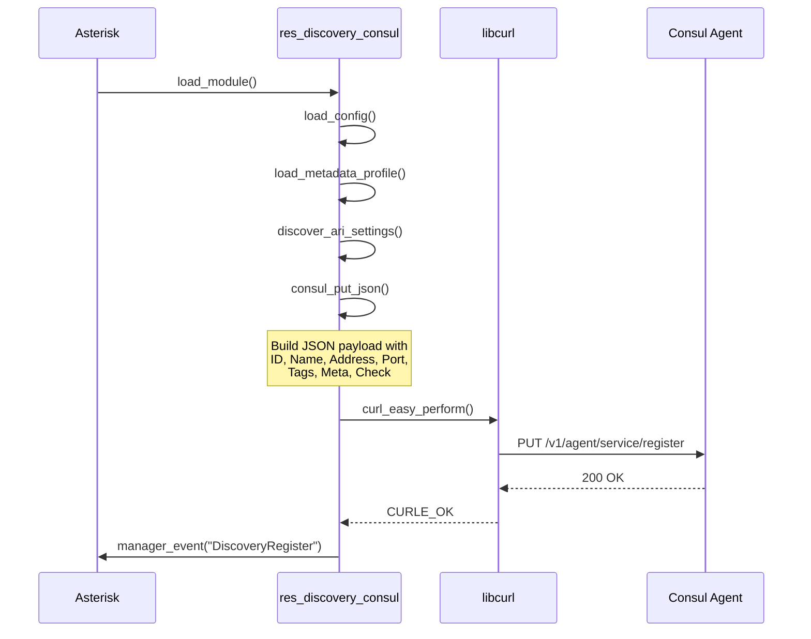
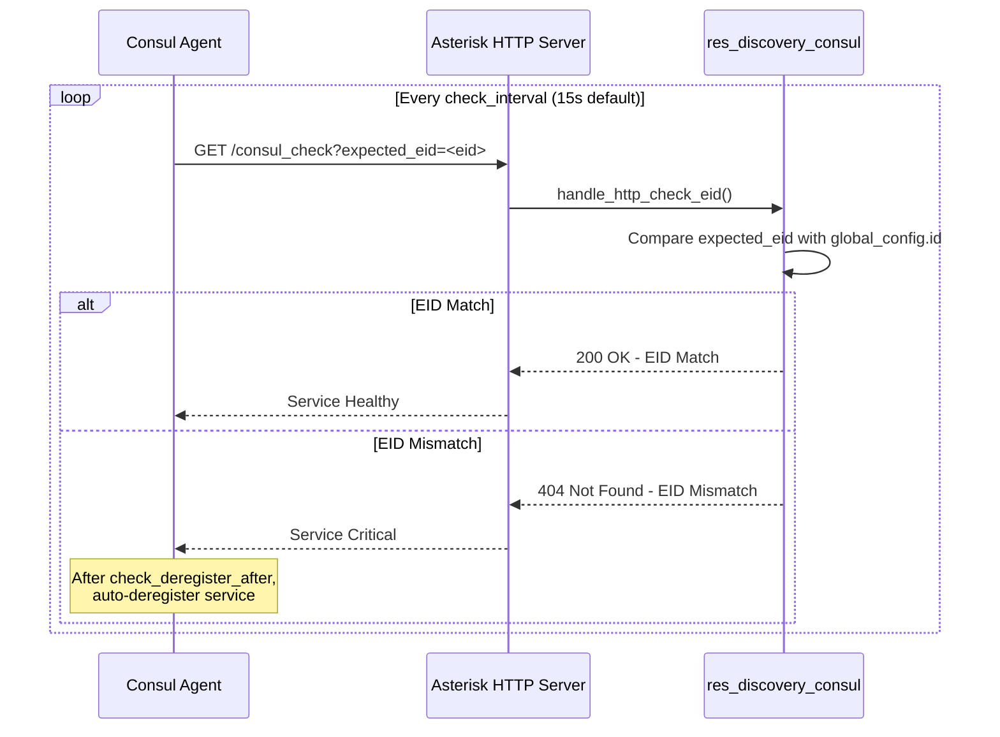
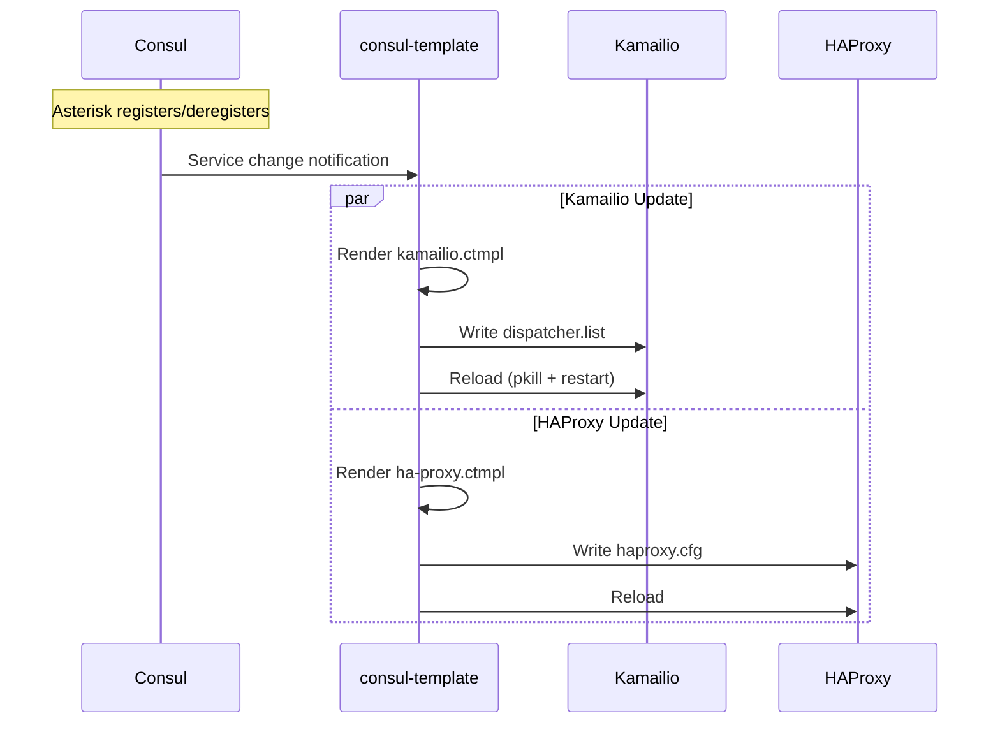
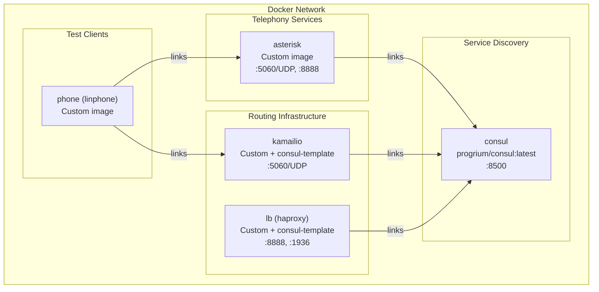
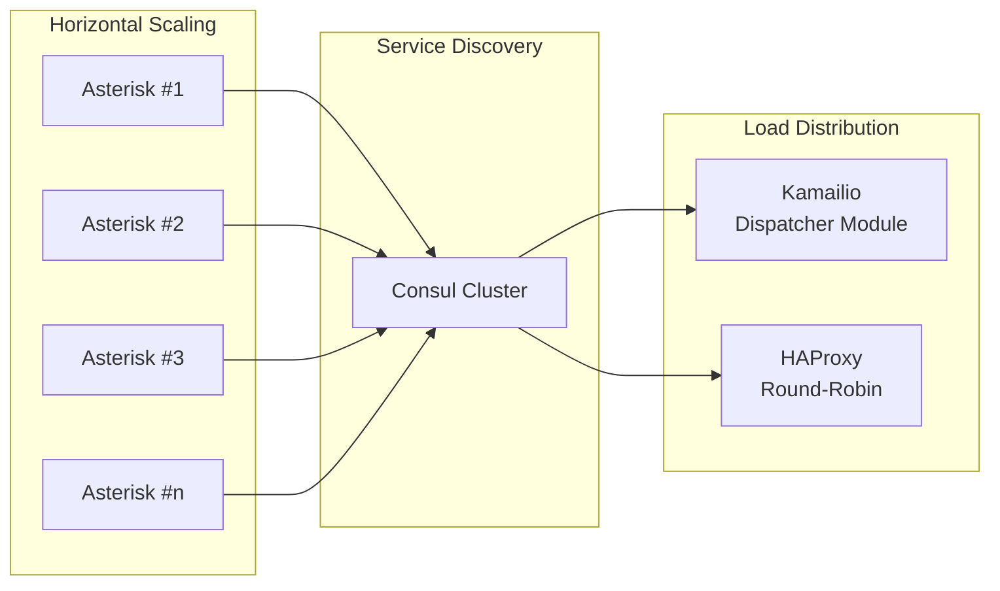
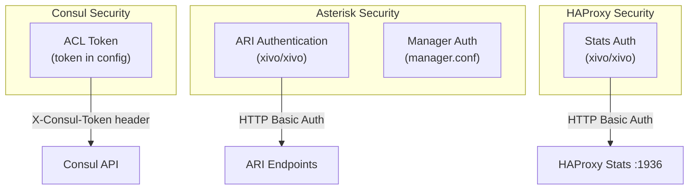

# Architecture Documentation

## High-Level Architecture Overview

res_discovery_consul is an Asterisk resource module that enables dynamic service discovery through HashiCorp Consul. It allows Asterisk instances to automatically register themselves with Consul, enabling other infrastructure components (SIP proxies, load balancers) to discover and route traffic to available Asterisk instances.



## Component Breakdown and Responsibilities

### Core Components

| Component | Responsibility |
|-----------|----------------|
| **res_discovery_consul** | Asterisk module that handles Consul registration, health check endpoint, metadata management |
| **Consul** | Service registry storing registered Asterisk instances with health status |
| **consul-template** | Watches Consul for service changes and regenerates configuration files |
| **Kamailio** | SIP proxy that routes calls to discovered Asterisk instances via dispatcher module |
| **HAProxy** | HTTP load balancer for ARI (Asterisk REST Interface) endpoints |

### Module Internal Architecture



## Data Flow Between Components

### Service Registration Flow



### Health Check Flow



### Dynamic Configuration Update Flow



## External Integrations and Third-Party Services

### Consul REST API Integration

The module communicates with Consul using the following API endpoints:

| Endpoint | Method | Purpose |
|----------|--------|---------|
| `/v1/agent/service/register` | PUT | Register service with health check |
| `/v1/agent/service/deregister/:id` | PUT | Deregister service |
| `/v1/agent/service/maintenance/:id` | PUT | Enable/disable maintenance mode |
| `/v1/agent/health/service/id/:id` | GET | Check service health status |

### consul-template Integration

consul-template watches Consul's service catalog and regenerates configuration files:

**Kamailio dispatcher.list template:**
```hcl
{{range service "asterisk"}}
1 sip:{{.Address}}:{{.Port}}
{{end}}
```

**HAProxy backend template:**
```hcl
{{range service "asterisk"}}
    server {{.Node}} {{.Address}}:8888 check
{{end}}
```

## Infrastructure and Deployment Topology

### Docker Compose Deployment



### Scaling Considerations



**Scaling commands:**
```bash
# Scale Asterisk instances
docker-compose scale asterisk=5
```

## Security Architecture

### Authentication & Authorization



### Network Security Considerations

| Port | Protocol | Service | Security Notes |
|------|----------|---------|----------------|
| 5060 | UDP | SIP | Should be firewalled to trusted networks |
| 8088 | TCP | ARI/HTTP | Health check port, requires auth for ARI |
| 8500 | TCP | Consul | Should use ACL tokens in production |
| 1936 | TCP | HAProxy Stats | Requires authentication |

### Health Check Security

The EID-based health check provides security against stale service entries:

1. **Problem**: When an IP address is reassigned, Consul may still have the old service registered
2. **Solution**: Each health check includes `expected_eid` parameter unique to the instance
3. **Validation**: Health endpoint verifies EID matches, returns 404 on mismatch
4. **Auto-cleanup**: Consul deregisters after `check_deregister_after` timeout

### Token Configuration

```ini
# res_discovery_consul.conf
[consul]
token=your-consul-token-here
```

The token is appended as a query parameter to all Consul API requests:
- `?token=<token>` for registration/deregistration
- `&token=<token>` for maintenance operations

## Deployment Patterns

### Single Instance

```
Consul <---> Asterisk (with res_discovery_consul)
```

### Multi-Instance with Load Balancing

```
                     ┌─── Asterisk #1
Consul <---> HAProxy ├─── Asterisk #2
                     └─── Asterisk #3
```

### Full Stack with SIP Proxy

```
                      ┌─── Asterisk #1
SIP Client --> Kamailio ├─── Asterisk #2
                      └─── Asterisk #3
                           │
                       Consul (Service Registry)
```
