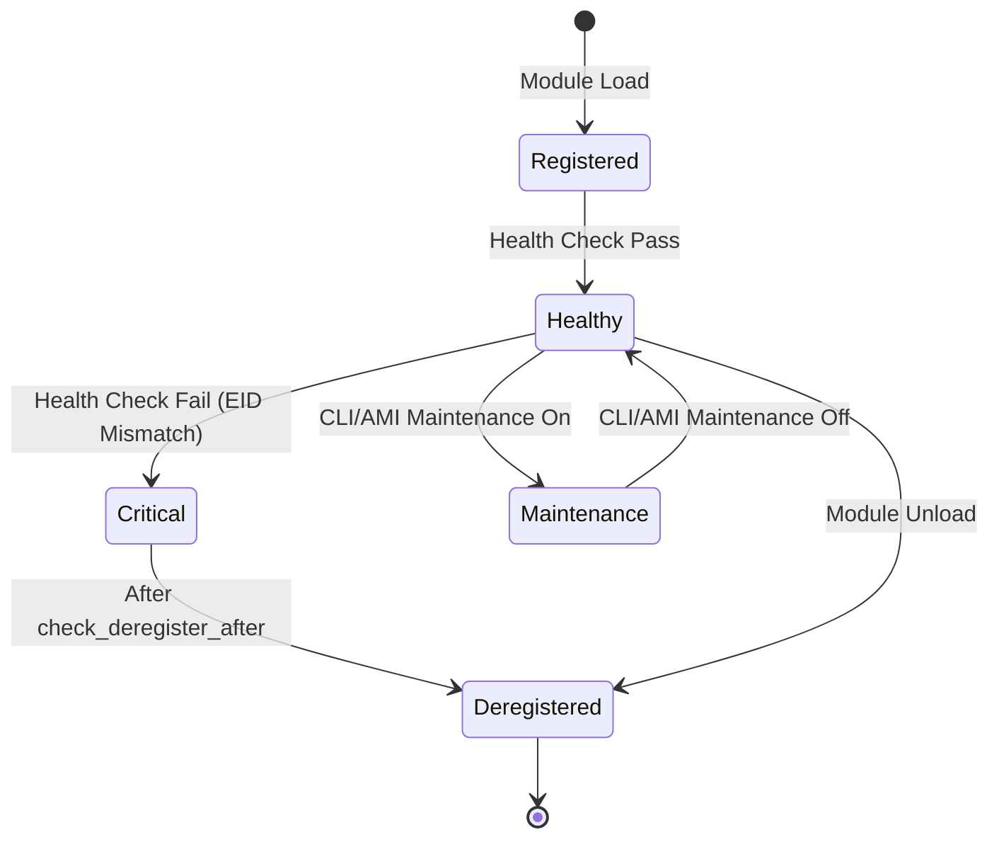
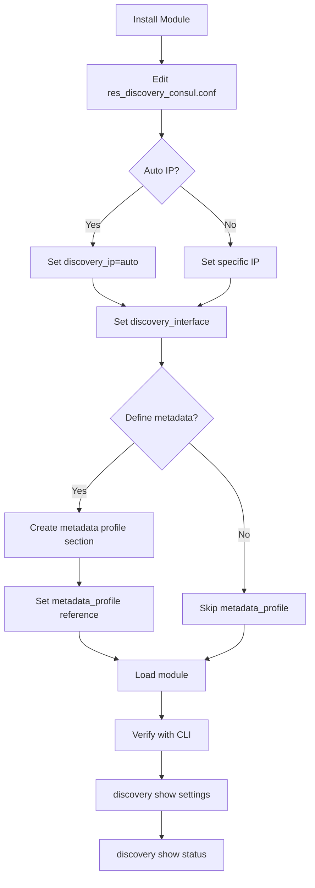
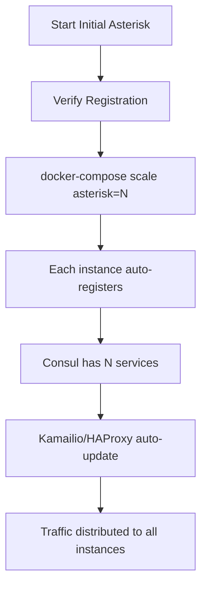
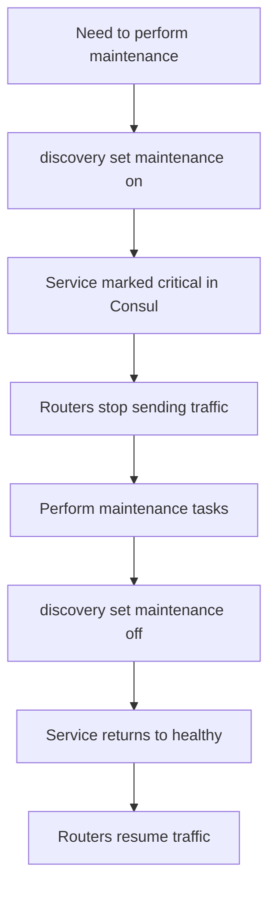
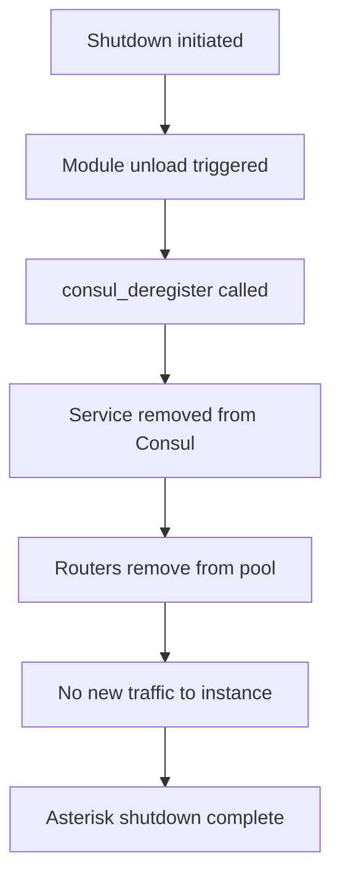

# Features Documentation

## Core Features and Business Logic

### Service Discovery Registration

The primary function of res_discovery_consul is to register Asterisk instances with HashiCorp Consul for dynamic service discovery.

**Key Capabilities:**
- Automatic service registration on module load
- Automatic deregistration on module unload or Asterisk shutdown
- Configurable service metadata (ID, name, tags, address, port)
- Support for auto-discovery of IP address and hostname
- EID (Endpoint Identifier) based unique identification

### Health Check Management

The module implements an advanced EID-based health check mechanism:



**Health Check Features:**
- HTTP-based health check endpoint at `/consul_check`
- EID verification prevents stale entries on IP reuse
- Configurable check interval, timeout, and deregistration delay
- Automatic deregistration after prolonged failure

### Maintenance Mode

Toggle service availability without deregistering:

```bash
# Enable maintenance (service marked unavailable in Consul)
asterisk -rx "discovery set maintenance on"

# Disable maintenance (service returns to normal)
asterisk -rx "discovery set maintenance off"
```

### Metadata Profiles

Support for custom routing metadata consumed by SIP proxies:

| Field | Purpose | Example |
|-------|---------|---------|
| group | Service grouping with ID and name | `{"id": 1, "name": "voice-primary"}` |
| priority | Routing priority (lower = higher) | `0` |
| weight | Load balancing weight | `100` |
| max_calls | Concurrent call limit | `50` |
| flags | Dispatcher-specific flags | `0` |

## User Interfaces

### CLI Commands

| Command | Description |
|---------|-------------|
| `discovery show settings` | Display all configuration values |
| `discovery show status` | Show registration and health status |
| `discovery set maintenance {on\|off}` | Toggle maintenance mode |

**Example: Show Settings Output**
```
Global Settings:
----------------
ID service: asterisk-voice-01
Name service: Asterisk-Voice-Primary
Tags service: asterisk,voice,production

ARI Port (Discovered): 8088
ARI Scheme (Discovered): http

Discovery Settings:
-------------------
Discovery ip: 192.168.1.100
Discovery port: 5060
Discovery interface: eth0

Consul Settings:
----------------
Connection: 127.0.0.1:8500
Token: ****
Check: 1
Check http port: 8088

Check interval: 15s
Check timeout: 3s
Check deregister after: 30s

Metadata Profile Settings:
--------------------------
Profile name: voice_primary_us_east
Profile status: Loaded successfully
Group: {"id": 1, "name": "voice-primary-us-east"}
Priority: 0
Weight: 100
Max Calls: 50
Flags: 0
```

### Manager Interface (AMI)

**Action: DiscoverySetMaintenance**
```
Action: DiscoverySetMaintenance
Enable: true
```

**Events Generated:**
| Event | Triggered When |
|-------|----------------|
| `DiscoveryRegister` | Service registered with Consul |
| `DiscoveryDeregister` | Service deregistered from Consul |
| `DiscoverySetMaintenance` | Maintenance mode toggled |

## Feature Matrix by Component

### Core Module (res_discovery_consul.c)

| Feature | Status | Notes |
|---------|--------|-------|
| Service Registration | Complete | Full Consul API support |
| Service Deregistration | Complete | On unload/shutdown |
| HTTP Health Check | Complete | EID-based verification |
| Maintenance Mode | Complete | CLI and AMI |
| Auto IP Discovery | Complete | From network interface |
| Auto Hostname | Complete | From system |
| Auto UUID ID | Complete | Generated UUID |
| EID-based ID | Complete | Uses Asterisk EID |
| Metadata Profiles | Complete | Telecom routing fields |
| ARI Settings Discovery | Complete | Reads http.conf |
| CLI Commands | Complete | show/set commands |
| AMI Integration | Complete | Action and events |

### Integration Components

| Component | Feature | Status |
|-----------|---------|--------|
| Kamailio | Dynamic dispatcher.list | Complete |
| HAProxy | Dynamic backend config | Complete |
| Linphone | Test client | Complete |
| Docker | Multi-service deployment | Complete |

## User Workflows

### Initial Setup Workflow



### Scaling Workflow



### Maintenance Workflow



### Graceful Shutdown Workflow



## Integration Points

### Kamailio Dispatcher Integration

The module provides metadata consumed by Kamailio's dispatcher module via consul-template:

**Template (kamailio.ctmpl):**
```hcl
{{range service "asterisk"}}
1 sip:{{.Address}}:{{.Port}}
{{end}}
```

**Generated dispatcher.list:**
```
1 sip:192.168.1.100:5060
1 sip:192.168.1.101:5060
1 sip:192.168.1.102:5060
```

The metadata fields (group, priority, weight) can be used for advanced routing:
- **group**: Route to specific service groups
- **priority**: Prefer lower priority instances
- **weight**: Weighted load distribution
- **max_calls**: Capacity-aware routing

### HAProxy Integration

HAProxy receives backend configuration via consul-template:

**Template (ha-proxy.ctmpl):**
```hcl
backend asterisk
    balance roundrobin
{{range service "asterisk"}}
    server {{.Node}} {{.Address}}:8888 check
{{end}}
```

**Generated haproxy.cfg:**
```
backend asterisk
    balance roundrobin
    server asterisk-1 192.168.1.100:8888 check
    server asterisk-2 192.168.1.101:8888 check
```

### Consul API Integration

**Service Query:**
```bash
# List registered asterisk services
curl http://localhost:8500/v1/catalog/service/asterisk

# Check service health
curl http://localhost:8500/v1/health/service/asterisk
```

**Service Data Available in Consul:**
- Service ID, Name, Address, Port
- Tags (searchable)
- Meta fields (eid, ari_port, ari_scheme, routing metadata)
- Health check status

## Current Limitations

### Functional Limitations

| Limitation | Description | Workaround |
|------------|-------------|------------|
| HTTP Only | No HTTPS for Consul API | Use network isolation |
| Single Tag String | Tags not parsed as array | Use comma-separated |
| No KV Store | Cannot store custom config | Use metadata fields |
| No TTL Check | Only HTTP check supported | Use check_interval tuning |
| IPv4 Only | discovery_ip is 16 chars | Manual config for IPv6 |

### Operational Limitations

| Limitation | Description | Impact |
|------------|-------------|--------|
| Single Consul Agent | Connects to one agent | No agent failover |
| No Connection Pooling | New cURL handle per request | Minor performance |
| Sync Registration | Blocks on Consul API | Startup delay if Consul slow |

### Configuration Limitations

| Limitation | Description |
|------------|-------------|
| Fixed buffer sizes | 256 chars for most strings |
| Single metadata profile | One profile per instance |
| No dynamic reload | Config changes need module reload |

## Planned Enhancements (Roadmap)

From README.md:

| Feature | Description | Status |
|---------|-------------|--------|
| HTTPS API | Consul API via HTTPS | Planned |
| KV Store Support | Store custom Asterisk config | Planned |
| TTL Health Check | Push-based health reporting | Planned |
| CLI Check Toggle | Enable/disable health check at runtime | Planned |
| Event Firing | Consul event API on register/deregister | Planned |

## Potential Future Features

### Enhanced Routing Metadata

Support for additional SIP proxy features:
- Socket information (transport type)
- Latency-based routing data
- Geographic region tags
- Capacity metrics

### Cluster Awareness

- Multiple Consul agent support with failover
- Consul cluster health monitoring
- Cross-datacenter service discovery

### Operational Improvements

- Prometheus metrics endpoint
- Structured logging (JSON)
- Configuration via environment variables
- Hot reload without module restart

### Security Enhancements

- TLS client certificates for Consul
- Vault integration for token management
- ACL policy recommendations
