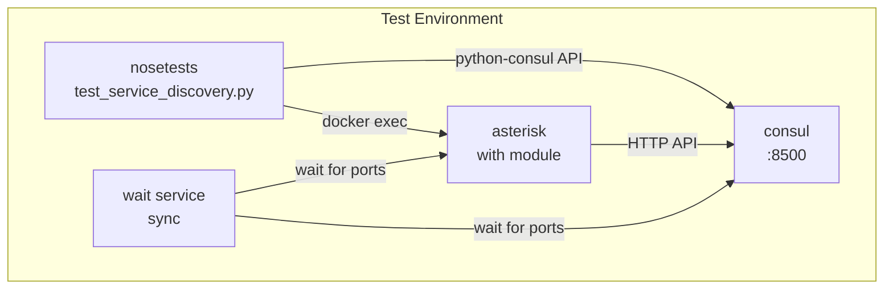

# Technical Documentation

## Technology Stack

### Core Module

| Component | Technology | Version |
|-----------|------------|---------|
| Language | C (C99) | - |
| HTTP Client | libcurl | Latest |
| JSON Handling | Asterisk JSON API (ast_json) | - |
| Build System | Make | - |
| Target Platform | Asterisk | 13.x+ |

### Runtime Dependencies

| Dependency | Version | Purpose |
|------------|---------|---------|
| Asterisk | >= 13.5.0 | Core telephony engine |
| libcurl | Latest | Consul HTTP API communication |
| Consul | Latest | Service discovery backend |

### Build Dependencies

| Dependency | Version | Purpose |
|------------|---------|---------|
| asterisk-dev | >= 13.5.0 | Asterisk development headers |
| debhelper | >= 7.0.50~ | Debian package building |
| gcc | Standard | C compiler |

### Integration Test Stack

| Component | Version | Purpose |
|-----------|---------|---------|
| Python | 2.7 | Test execution |
| nose | Latest | Test runner |
| python-consul | Latest | Consul API client |
| pyhamcrest | Latest | Test assertions |
| xivo-test-helpers | Latest | Test framework |
| docker-compose | 1.4.2 | Container orchestration |
| requests | >= 2.6.1, < 2.7 | HTTP client |

### Container Images

| Image | Purpose |
|-------|---------|
| quintana/asterisk:latest | Base Asterisk image |
| progrium/consul:latest | Consul service |
| n3llyb0y/wait | Container synchronization |

## Project Structure and Organization

```
res-discovery-consul/
├── res_discovery_consul.c          # Main module source (~1400 lines)
├── res_discovery_consul.conf.sample # Configuration template
├── Makefile                         # Build system
├── Dockerfile                       # Main Docker image
├── docker-compose.yml               # Multi-service deployment
├── README.md                        # User documentation
├── CLAUDE.md                        # AI assistant guidance
├── COPYING                          # License (GPLv3)
│
├── debian/                          # Debian packaging
│   ├── control                      # Package metadata
│   ├── rules                        # Build rules
│   ├── changelog                    # Version history
│   ├── copyright                    # Copyright info
│   ├── compat                       # Debhelper compat level
│   └── res-discovery-consul.install # Install manifest
│
├── integration_tests/               # Test suite
│   ├── Makefile                     # Test commands
│   ├── test-requirements.txt        # Python dependencies
│   ├── suite/
│   │   └── test_service_discovery.py
│   └── assets/
│       └── service_discovery/
│           └── docker-compose.yml   # Test environment
│
├── contribs/                        # Integration examples
│   ├── asterisk/                    # Asterisk configs
│   │   ├── modules.conf
│   │   ├── http.conf
│   │   ├── ari.conf
│   │   ├── pjsip.conf
│   │   ├── sip.conf
│   │   ├── extensions.conf
│   │   ├── manager.conf
│   │   ├── logger.conf
│   │   ├── cel.conf
│   │   └── musiconhold.conf
│   │
│   ├── kamailio/                    # Kamailio SIP proxy
│   │   ├── Dockerfile
│   │   └── config/
│   │       ├── kamailio/
│   │       │   ├── kamailio.cfg
│   │       │   └── dispatcher.list
│   │       └── consul-template/
│   │           ├── template.hcl
│   │           └── kamailio.ctmpl
│   │
│   ├── haproxy/                     # HAProxy load balancer
│   │   ├── Dockerfile
│   │   └── config/
│   │       ├── template.hcl
│   │       └── ha-proxy.ctmpl
│   │
│   ├── linphone/                    # SIP test client
│   │   ├── Dockerfile
│   │   ├── linphone.sh
│   │   └── config/
│   │       └── linphonerc
│   │
│   └── images/                      # Architecture diagrams
│       ├── asterisk-consul.png
│       ├── asterisk-consul-kamailio.png
│       └── asterisk-consul.dia
│
└── docs/                            # Documentation
    ├── architecture.md
    ├── technical.md
    └── features.md
```

## Data Structures

### Global Configuration Structure

```c
struct discovery_config {
    int enabled;                    // Module enable flag
    char id[256];                   // Service ID (or "auto"/"asterisk")
    char name[256];                 // Service name (or "auto")
    char host[256];                 // Consul agent host
    char discovery_ip[16];          // IP to advertise (or "auto")
    int discovery_port;             // Port to advertise (default: 5060)
    char discovery_interface[32];   // Network interface for auto IP
    int port;                       // Consul agent port (default: 8500)
    char tags[256];                 // Service tags
    char token[256];                // Consul ACL token
    int check;                      // Enable health check
    int check_http_port;            // Health check HTTP port (default: 8088)
    char check_interval[16];        // Health check interval (default: "15s")
    long consul_timeout_ms;         // API timeout (default: 2000)
    char ari_port[16];              // Discovered ARI port
    char ari_scheme[16];            // Discovered ARI scheme (http/https)
    char check_timeout[16];         // Health check timeout (default: "3s")
    char check_deregister_after[16]; // Auto-deregister timeout (default: "30s")
    char metadata_profile[64];       // Metadata profile reference
};
```

### Metadata Profile Structure

```c
struct metadata_profile {
    char profile_name[64];    // Profile identifier
    char group[256];          // JSON: {"id": N, "name": "..."}
    char priority[16];        // Routing priority (default: "0")
    char weight[16];          // Load balancing weight (default: "0")
    char max_calls[16];       // Max concurrent calls (default: "0")
    char flags[16];           // Dispatcher flags (default: "0")
    int valid;                // Profile loaded successfully
};
```

### cURL Data Structure

```c
struct curl_put_data {
    char *original_data_ptr;      // Original allocated buffer
    const char *current_read_ptr; // Current read position
    size_t remaining_size;        // Bytes remaining to read
};
```

## API Design

### Consul REST API Endpoints Used

| Endpoint | Method | Request Body | Purpose |
|----------|--------|--------------|---------|
| `/v1/agent/service/register` | PUT | JSON service definition | Register service |
| `/v1/agent/service/deregister/{id}` | PUT | None | Deregister service |
| `/v1/agent/service/maintenance/{id}` | PUT | Empty JSON | Toggle maintenance |
| `/v1/agent/health/service/id/{id}` | GET | None | Check service health |

### Service Registration JSON Schema

```json
{
    "ID": "asterisk-eid-xxxx",
    "Name": "Asterisk",
    "Address": "192.168.1.100",
    "Port": 5060,
    "Tags": ["asterisk", "voice"],
    "Meta": {
        "eid": "xx:xx:xx:xx:xx:xx",
        "ari_port": "8088",
        "ari_scheme": "http",
        "group": "{\"id\": 1, \"name\": \"voice-primary\"}",
        "priority": "0",
        "weight": "100",
        "max_calls": "50",
        "flags": "0"
    },
    "Check": {
        "CheckID": "check-asterisk-eid-xxxx",
        "Name": "Asterisk Instance EID Verification",
        "HTTP": "http://192.168.1.100:8088/consul_check?expected_eid=xxxx",
        "Interval": "15s",
        "Timeout": "3s",
        "DeregisterCriticalServiceAfter": "30s"
    }
}
```

### HTTP Health Check Endpoint

**Endpoint:** `GET /consul_check`

**Query Parameters:**
- `expected_eid` (required): Expected Endpoint Identifier

**Responses:**

| Status | Condition | Body |
|--------|-----------|------|
| 200 OK | EID matches | `OK - EID Match: <eid>` |
| 400 Bad Request | Missing expected_eid | Error message |
| 404 Not Found | EID mismatch | `EID Mismatch. Expected: X, Instance has: Y` |
| 405 Method Not Allowed | Non-GET request | Error message |
| 500 Internal Server Error | Config error | Error message |

## Configuration Management

### Configuration File: `res_discovery_consul.conf`

```ini
[general]
enabled=yes                          ; Enable/disable module

[consul]
; Consul Agent Connection
host=127.0.0.1                       ; Consul agent hostname
port=8500                            ; Consul agent port
token=your-consul-token              ; ACL token (optional)

; Service Registration
id=asterisk-voice-01                 ; Service ID ("auto" or "asterisk" for EID)
name=Asterisk-Voice                  ; Service name ("auto" for hostname)
discovery_ip=auto                    ; IP to advertise ("auto" for interface IP)
discovery_port=5060                  ; Port to advertise
discovery_interface=eth0             ; Interface for auto IP discovery
tags=asterisk,voice                  ; Comma-separated tags

; Metadata Profile
metadata_profile=voice_primary       ; Reference to [metadata_*] section

; Health Check
check=yes                            ; Enable health check
check_http_port=8088                 ; Port for health check endpoint
check_interval=15s                   ; How often Consul checks
check_timeout=3s                     ; HTTP request timeout
check_deregister_after=30s           ; Auto-deregister after critical

; Advanced
consul_timeout_ms=2000               ; API request timeout

[metadata_voice_primary]
group={"id": 1, "name": "voice-primary"}
priority=0
weight=100
max_calls=50
flags=0
```

### Auto-Discovery Features

| Setting | Auto Value | Behavior |
|---------|------------|----------|
| `id` | `auto` | Generates UUID |
| `id` | `asterisk` | Uses Asterisk EID (MAC-based) |
| `name` | `auto` | Uses system hostname |
| `discovery_ip` | `auto` | Gets IP from `discovery_interface` |

## Build and Deployment

### Build Commands

```bash
# Standard build
make

# Install to Asterisk modules directory
make install    # Installs to /usr/lib/asterisk/modules/

# Install sample configuration
make samples    # Installs to /etc/asterisk/

# Clean build artifacts
make clean
```

### Makefile Details

```makefile
TARGET = res_discovery_consul.so
OBJECTS = res_discovery_consul.o

CFLAGS += -Wall -Werror -Wextra -Wno-unused-parameter \
          -Wstrict-prototypes -Wmissing-prototypes \
          -Wmissing-declarations -Winit-self \
          -Wmissing-format-attribute -Wformat=2 \
          -g -fPIC -D_GNU_SOURCE \
          -D'AST_MODULE="res_discovery_consul"' \
          -D'AST_MODULE_SELF_SYM=__internal_res_discovery_consul_self'

LIBS += -lcurl
LDFLAGS += -Wall -shared
```

### Debian Package Build

```bash
# Build .deb package
dpkg-buildpackage -us -uc

# Produces:
# - res-discovery-consul_<version>_<arch>.deb
# - res-discovery-consul-dbg_<version>_<arch>.deb
```

### Docker Build

```bash
# Build main image
docker build -t asterisk-consul .

# Build with docker-compose
docker-compose build --no-cache

# Run interactive
docker run -it asterisk-consul bash
```

## Testing Strategy

### Integration Test Architecture



### Test Cases

| Test | Purpose | Method |
|------|---------|--------|
| `test_that_asterisk_is_registered_and_deregistered` | Verify registration lifecycle | Query Consul, stop container, verify deregistration |
| `test_that_asterisk_has_maintenance_mode` | Verify maintenance toggle | CLI command, verify Consul health state |

### Running Tests

```bash
cd integration_tests

# Install dependencies
pip install -r test-requirements.txt

# Pull required Docker images
make test-setup

# Run tests
make test
```

### Test Helpers

```python
class ConsulModuleIntegrationTests(AssetLaunchingTestCase):
    asset = 'service_discovery'  # Uses assets/service_discovery/docker-compose.yml

    def _is_asterisk_registered_to_consul(self):
        """Query Consul API for asterisk service."""
        consul = Consul('localhost', '8500', 'the_one_ring')
        services = consul.agent.services()
        # Verify service with matching IP exists

    def _run_cmd_cli(self, container, cmd):
        """Execute command in Docker container."""
        c = Client(base_url='unix://var/run/docker.sock')
        exec_id = c.exec_create(container, cmd)
        return c.exec_start(exec_id)
```

## Code Quality

### Compiler Warnings Enabled

```
-Wall -Werror -Wextra
-Wno-unused-parameter
-Wstrict-prototypes
-Wmissing-prototypes
-Wmissing-declarations
-Winit-self
-Wmissing-format-attribute
-Wformat=2
```

### Coding Guidelines

The module follows Asterisk coding guidelines:
- https://docs.asterisk.org/Development/Policies-and-Procedures/Coding-Guidelines/

Key patterns used:
- `RAII_VAR` macro for automatic cleanup
- `ast_copy_string` for safe string copying
- `ast_str_alloca` for stack-allocated dynamic strings
- `ast_debug` / `ast_log` for logging
- `ast_json_*` API for JSON handling

### Memory Management

```c
// RAII pattern for automatic cleanup
RAII_VAR(struct ast_json *, obj, ast_json_object_create(), ast_json_unref);

// Manual allocation with cleanup
char *allocated_buffer = ast_strndup(json_str, json_len);
// ... use buffer ...
ast_free(allocated_buffer);
```

## Development Environment Setup

### Prerequisites

1. Install Asterisk development headers:
```bash
apt-get install asterisk-dev
```

2. Install libcurl:
```bash
apt-get install libcurl4-openssl-dev
```

3. Build and install:
```bash
make
sudo make install
sudo make samples
```

### Docker Development

```bash
# Start full stack
docker-compose up -d

# Scale Asterisk instances
docker-compose scale asterisk=3

# View logs
docker-compose logs -f asterisk

# Access Asterisk CLI
docker-compose exec asterisk asterisk -r
```

### Asterisk CLI Commands for Development

```bash
# Reload configuration
CLI> module reload res_discovery_consul.so

# Load/unload module
CLI> module unload res_discovery_consul.so
CLI> module load res_discovery_consul.so

# Check status
CLI> discovery show settings
CLI> discovery show status

# Toggle maintenance
CLI> discovery set maintenance on
CLI> discovery set maintenance off

# Enable debug logging
CLI> core set debug 3
```

## Known Technical Debt

### Current Limitations

1. **HTTP Only**: Consul API communication is HTTP-only; HTTPS not implemented
2. **Single Tag Support**: Tags field accepts string, not array
3. **No KV Store**: Consul KV features not implemented
4. **No TTL Check**: Only HTTP health check supported, not TTL-based

### Potential Improvements

1. **HTTPS Support**: Add TLS for Consul API communication
2. **Multiple Tags**: Parse comma-separated tags into JSON array
3. **Consul KV Integration**: Store/retrieve configuration from Consul KV
4. **TTL Health Check**: Add push-based health reporting option
5. **Connection Pooling**: Reuse cURL handles for efficiency
6. **Graceful Shutdown**: Ensure deregistration on all exit paths
7. **Event Firing**: Implement Consul event API integration (roadmap item)

### Code Quality Notes

- Test suite uses Python 2.7 patterns (deprecated)
- docker-compose version 1.4.2 is outdated
- Some variable naming inconsistencies (e.g., `ari_port` for HTTP settings)
